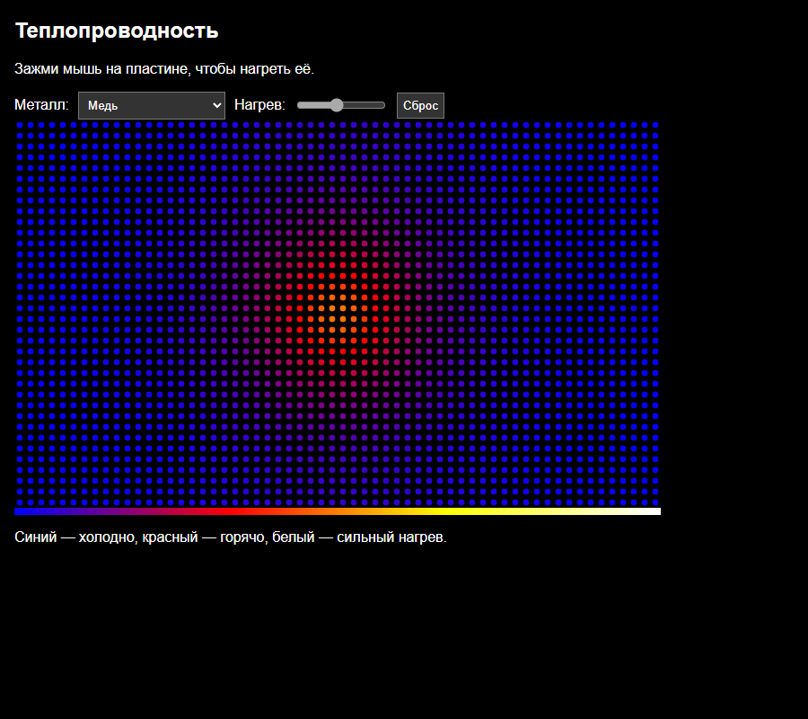

# Теплопроводность

Простой учебный проект на JavaScript и p5.js. Пластина состоит из точек. Зажмите мышь над пластиной: точки нагреваются и передают тепло соседям. Цвет меняется от синего через красный и жёлтый до белого.

## Запуск

Откройте index.html в браузере. Интернет не нужен, библиотека p5.js находится в папке code. Отдельного CSS-файла нет.

Автономные HTML-версии можно скачать и открыть в браузере без интернета.

- [Базовая версия](heat-conduction-basic.html) — выбор металла, нагрев мышью и сброс.
- [Расширенная версия](heat-conduction-advanced.html) — постоянный нагрев, тепловой импульс, пауза и настройка теплоотдачи.

Для p5.js Web Editor загрузите index.html, sketch.js и p5.min.js. В index.html уберите из адресов скриптов префикс code/. Код sketch.js содержит всю модель и интерфейс.

## Управление

- Выбор металла: медь, алюминий или нержавеющая сталь. Смена металла сбрасывает поле.
- Ползунок «Нагрев»: сила воздействия мыши.
- Кнопка «Сброс»: возвращает все точки в холодное состояние.
- Зажатая мышь: нагревает область радиусом четыре узла.

## Как работает

У каждой точки есть температура от 0 до 1. На каждом шаге берутся четыре соседа и вычисляется новая температура:

Tnew = T + k × (левый + правый + верхний + нижний − 4 × T).

Два массива нужны, чтобы все новые значения вычислялись по старому состоянию. На границах отсутствующий сосед заменяется самой точкой. Небольшие потери имитируют остывание. Коэффициенты k: медь — 0,22, алюминий — 0,186, нержавеющая сталь — 0,007. Это условные коэффициенты для наглядного сравнения скорости распространения.

Температура и время условные, точки — узлы сетки, а не атомы. Плавление не рассчитывается. Выполняется четыре шага за кадр; скорость опыта зависит от частоты кадров.

## Требования задания

| Требование | Где используется |
| --- | --- |
| Переменные и массивы | cols, rows, k; temperature и next |
| Циклы | for для обхода точек и расчёта |
| Условные операторы | if для выбора металла, нагрева и цвета |
| Функции | setup(), draw(), resetPlate(), heatColor() |

В проекте всего четыре собственные функции. Классов и дополнительных модулей нет.

## Проверка

1. Зажать мышь: появляется горячее пятно.
2. Отпустить: пятно расширяется и остывает.
3. Повторить на стали: тепло дольше остаётся около источника.
4. Нажать «Сброс»: все точки снова синие.

## Файлы

- index.html — страница и оформление.
- code/sketch.js — весь код проекта.
- code/p5.min.js — библиотека p5.js.
- media/preview.png — скриншот.
- THIRD_PARTY.md — сведения о библиотеке и лицензии.

